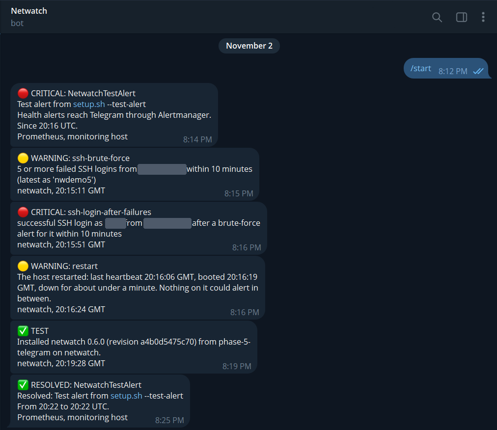
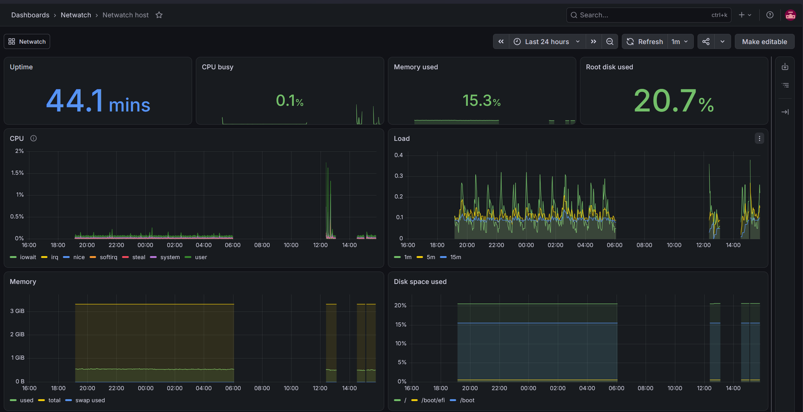

# netwatch

A home-network security monitor that runs as a set of hardened systemd services on a Linux host
on the LAN. It answers and blocks DNS for the devices pointed at it and stores every query,
watches SSH logins for brute-force attacks, keeps an inventory of every device on the LAN and
alerts on new ones, exports its numbers and its own health to Prometheus and Grafana, and sends
its alerts to Telegram. It was built in five phases, each a tagged release, and runs on an Ubuntu
Server VM on a real home network.

**Status: v0.6.0; all five phases are done.**



*The bot chat after the live test on 2 November (the admin PC's address and the account name are
hidden). From the top: Alertmanager's test alert; the failed-login demo, a silent warning and then
a critical alert, with sound, for the login that followed it; the notice after a reboot of the
VM; the message every install sends; the test alert resolving. "Since 20:16" and "about under a
minute" are two of the bugs this run found; all were fixed before the release
([docs/alerting.md](docs/alerting.md#tested)).*



*The Netwatch host dashboard in Grafana on 31 October. The gaps are times the host PC was down (a
morning outage, a crash and a BIOS update); each time, the VM and its exporter came back on their
own.*

## What it does

| Part | What it does | Since |
|---|---|---|
| DNS | dnsmasq answers on the host's LAN address and blocks about 76,000 ad and tracker domains (StevenBlack's list, updated daily); Netwatch stores every query for 30 days | v0.2.0 |
| SSH logins | Follows sshd's log and stores every login; alerts on 5 failures from one address in 10 minutes, and critically on a successful login right after | v0.3.0 |
| LAN devices | An ARP scan every five minutes; inventory with vendors and address history; one alert per new MAC address after the first (baseline) scan | v0.4.0 |
| Monitoring | Prometheus metrics through node_exporter; Prometheus, Alertmanager and Grafana on a separate host, with 12 health alerts and two dashboards | v0.5.0 |
| Telegram | Security alerts from `netwatch-notify` and health alerts from Alertmanager, one bot; no replays of old alerts, a cooldown, burst summaries, and a notice after the host restarts | v0.6.0 |

The details of each, with real output: [docs/usage.md](docs/usage.md). Setting up the monitoring
host: [docs/monitoring.md](docs/monitoring.md); Telegram: [docs/alerting.md](docs/alerting.md);
taking Netwatch out of the DNS path or going back a version: [docs/rollback.md](docs/rollback.md).

## How it works

```
 client --DNS--> dnsmasq (LAN address only) --forward--> 1.1.1.1 / 9.9.9.9
                   |  answers blocked names from /var/lib/netwatch-blocklist (inotify)
                   |  logs every query step to the journal (log-queries=extra)
                   v
 netwatch-dns: journalctl --follow -> assemble queries -> SQLite (+ resume cursor)
 netwatch-blocklist.timer (daily): download -> check -> atomic rename into the blocklist dir

 sshd / sshd-session --logs--> journal
 netwatch-auth: journalctl --follow -> log-analyzer SSHParser -> RateTracker per address
                -> logins + alerts -> SQLite (+ resume cursor)

 netwatch-discovery.timer (every 5 min) -> netwatch-discovery (CAP_NET_RAW only):
     ARP request to every address in eth0's subnet -> replies -> vendor (IEEE registry)
     -> devices + address history + new-device alerts -> SQLite

 netwatch-metrics.timer (every minute) -> netwatch metrics (read-only DB, no network):
     database -> Prometheus text file -> node_exporter (LAN address) <--scrape-- Prometheus -> Grafana
                                                                                  |
 netwatch-notify (every 10 s): alerts not yet sent -> Telegram Bot API     Alertmanager -> Telegram
     (cooldown, burst summary, restart alerts; token via LoadCredential)   (health alerts)
```

The key decisions (all of them, with the module map and their trade-offs:
[docs/design.md](docs/design.md)):

- **dnsmasq answers, Netwatch observes.** A small, packaged resolver is in the path of every
  lookup; Netwatch configures it, feeds it the blocklist and reads its log. If Netwatch's own
  services fail, dnsmasq keeps answering.
- **One unit per component, least privilege.** Every service runs as the `netwatch` user with
  only what it needs: the log followers have no network, the scanner has `CAP_NET_RAW` and no IP
  access, the metrics writer has neither. `systemd-analyze security` rates them 0.4 to 1.4; CI
  fails above 2.0.
- **Reuse, don't copy.** SSH parsing comes from [log-analyzer](https://github.com/iMovingTarget/log-analyzer),
  an earlier project, pinned to a tag; the bugs this host's real logs exposed were fixed there,
  with tests.
- **Metrics without a new port.** Netwatch writes a file that node_exporter serves. Counters
  survive retention, and no domain, address or MAC address ever becomes a metric label.
- **Two alert paths that watch each other.** `netwatch-notify` sends Netwatch's own alerts from
  the database, at least once; Alertmanager sends the health alerts, including "an alert has
  waited 10 minutes to be sent". The bot token reaches the notifier alone, through
  `LoadCredential=`.
- **Atomic, commit-pinned deploys.** `install.sh` builds a virtualenv for one commit and then
  switches a symlink; installing an older tag is the rollback, and CI tests it.
- **Detect, don't block.** Netwatch alerts but never changes firewall rules on its own:
  automatic bans can be turned against the admin.

## Quick start (development)

Python 3.12 or newer. `examples/` holds dnsmasq and sshd logs from the VM, anonymised with
documentation addresses, and saved LAN scans, so this works on any OS without dnsmasq or sshd (on
Windows use `py` and `set`):

```
git clone https://github.com/iMovingTarget/netwatch.git && cd netwatch
python3 -m venv .venv && . .venv/bin/activate
pip install -e ".[dev]"
export NETWATCH_STATE_DIR=var
```

```
$ netwatch auth watch --from-file examples/sshd-journal.jsonl
stored 12 new login events from examples/sshd-journal.jsonl, 1 alert
$ netwatch alerts
TIME                 SEVERITY  KIND             MESSAGE
2026-10-28 16:55:54  warning   ssh-brute-force  5 or more failed SSH logins from 203.0.113.5 within 10 minutes (latest as 'nwtest5')
```

The same for DNS queries and LAN scans: [docs/usage.md](docs/usage.md#trying-it-without-a-host).

## Deploying to a host

On a systemd-based Linux host on the LAN (developed on Ubuntu Server 26.04):

```
git clone https://github.com/iMovingTarget/netwatch.git && cd netwatch
sudo deploy/install.sh v0.6.0          # first install: creates /etc/netwatch/netwatch.env
sudoedit /etc/netwatch/netwatch.env    # DNS, discovery, metrics and Telegram settings
sudo deploy/install.sh v0.6.0          # again, with them
```

The end of the v0.6.0 release candidate's install on the VM (addresses and chat ID replaced):

```
install: node_exporter serves 30 netwatch samples on 192.0.2.53:9100
install: sending a test message to Telegram chat 123456789
test alert 14 sent to Telegram chat 123456789 in 3 s
install: installed netwatch 0.6.0 (revision a4b0d5475c70) from phase-5-telegram
install:   netwatch-auth.service: active
install:   netwatch-dns.service: active
install:   netwatch-notify.service: active
```

The full output, the files it installs and the day-to-day commands:
[docs/usage.md](docs/usage.md#deploying-to-a-host).

## Limitations

- **Test devices only.** The host is a VM on a desktop PC, so only devices pointed at it by hand
  use it; whole-house DNS needs always-on hardware (a mini PC is the plan).
- **Nothing can alert while that PC is down.** The restart notice arrives once it is back.
- **Encrypted DNS bypasses it** (DNS over HTTPS, Android's Private DNS, iCloud Private Relay),
  and no DNS blocker can remove ads served from the same domains as content.
- **SSH monitoring covers this host's sshd only**, which isn't reachable from the internet.
- **Discovery sees IPv4 devices on one subnet.** A sleeping phone can miss a scan, and a phone
  that changes its private Wi-Fi address looks like a new device.
- **Telegram is a dependency.** Alerts wait while it can't be reached, one token serves both
  senders, and messages with LAN addresses pass through Telegram's servers.
- **One host, Linux with systemd only.**

All of them, in detail: [docs/design.md](docs/design.md#limitations).

## Development

```
pip install -e ".[dev]"
pytest
ruff check .
ruff format --check .
shellcheck deploy/*.sh deploy/bin/netwatch monitoring/setup.sh
```

CI runs these on Python 3.12 to 3.14 on Linux and 3.14 on Windows, checks the Prometheus and
Alertmanager configurations with promtool and amtool, and deploys every pull request to a real
systemd host: DNS, failed logins, a test LAN of network namespaces, metrics, the monitoring stack
and Telegram (against a fake API), then a rollback, a reinstall and an uninstall. The full list
is in [docs/design.md](docs/design.md#testing).

AI-assisted implementation; architecture, operations and verification are human-owned.

## License

MIT. See [LICENSE](LICENSE).
