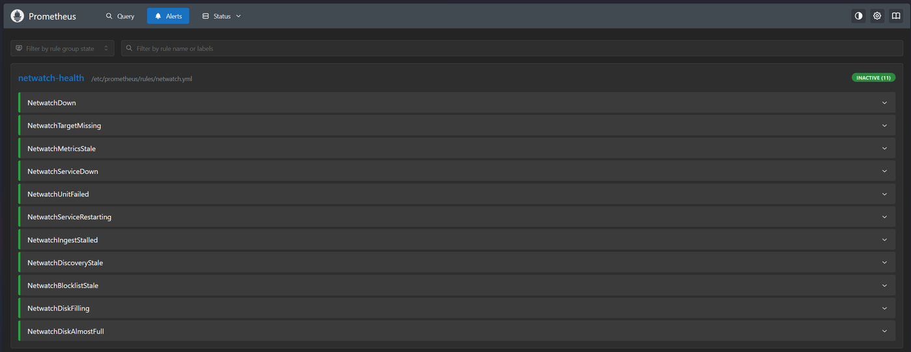
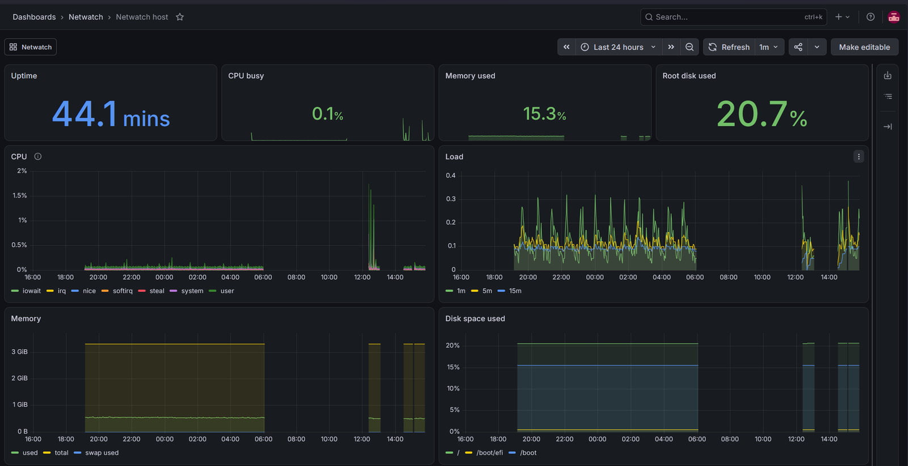

# Monitoring: Prometheus and Grafana

Netwatch's numbers (DNS queries, SSH logins, alerts, devices) and its own health go to
Prometheus and Grafana on a second host, the monitoring host. This page sets both hosts up and
explains what is measured and alerted on.

```
 Netwatch host                                    monitoring host (Docker)
 ------------------------------------------       ---------------------------------------
 netwatch-metrics.timer (every minute)            Prometheus  127.0.0.1:9090 (SSH tunnel)
   -> /var/lib/netwatch-metrics/netwatch.prom       scrapes every 30 s, evaluates the alerts
 node_exporter  LAN-address:9100  <---- scrape --   keeps 30 days / 5 GB
   host metrics + that file + unit states         Grafana  LAN-address:3000 (login)
   ufw: only from the monitoring host               two provisioned dashboards
```

Netwatch itself never listens on the network for this. `netwatch metrics` reads the database
read-only and writes a file; node_exporter, which is needed for the host's own metrics anyway,
serves it. The unit that writes the file has no network access at all.

## The Netwatch host

In `/etc/netwatch/netwatch.env`, then run `install.sh` again with the same release:

```
NETWATCH_METRICS_LISTEN=192.0.2.200        # this host's LAN address
NETWATCH_METRICS_ALLOW_FROM=192.0.2.201    # the monitoring host
```

`install.sh` installs Ubuntu's `prometheus-node-exporter` with a drop-in
(`/etc/systemd/system/prometheus-node-exporter.service.d/netwatch.conf`) that listens on that
address only, reads `/var/lib/netwatch-metrics`, reports the systemd state of Netwatch's units
and dnsmasq, and sandboxes node_exporter. It enables `netwatch-metrics.timer`, opens 9100/tcp in
ufw from the monitoring host only, writes the first metrics and checks node_exporter serves
them. Try it by hand:

```
netwatch metrics | head -n 4
curl -s http://192.0.2.200:9100/metrics | grep '^netwatch_dns'
```

## The monitoring host

A small Ubuntu Server 26.04 VM on the same LAN (2 CPUs, 3 GB RAM, 40 GB disk is plenty) with a
fixed address, for example a DHCP reservation on the router. As a user with sudo:

```
sudo git clone --branch v0.5.0 https://github.com/iMovingTarget/netwatch.git /opt/netwatch-monitoring
sudo /opt/netwatch-monitoring/monitoring/setup.sh       # first run: creates .env and stops
sudoedit /opt/netwatch-monitoring/monitoring/.env       # GRAFANA_LISTEN, NETWATCH_TARGET
sudo /opt/netwatch-monitoring/monitoring/setup.sh
```

`setup.sh` installs `docker.io` and `docker-compose-v2` from Ubuntu's archive (so
unattended-upgrades patches them), creates a random Grafana admin password in
`monitoring/secrets/grafana_admin_password`, writes the scrape target from `.env`, checks the
Prometheus configuration and runs the alert rules' unit tests, and only then (re)creates the
containers. It ends by printing the target's health:

```
setup: target netwatch: up
```

- **Grafana:** `http://<GRAFANA_LISTEN>:3000`, user `admin`, password in the file above. The
  password from that file is only used when Grafana creates its database; to change it later:
  `sudo docker compose -f /opt/netwatch-monitoring/monitoring/compose.yaml exec grafana grafana cli admin reset-admin-password NEW`.
  Other accounts (Administration > Users) are viewers by default. Sign-up and anonymous access
  are off.
- **Prometheus:** no login, so it listens on the host's loopback only. From your PC:
  `ssh -L 9090:127.0.0.1:9090 <user>@<monitoring host>`, then `http://localhost:9090`.
- **Update:** `cd /opt/netwatch-monitoring && sudo git fetch --tags && sudo git checkout v0.X.0`,
  then `setup.sh` again. Data stays in the Docker volumes `netwatch-monitoring_prometheus-data`
  and `netwatch-monitoring_grafana-data`.
- **Remove:** `sudo docker compose -f .../compose.yaml down` (add `--volumes` to delete the
  data too).

Docker writes its own iptables rules for published ports, and they take effect before ufw's.
So ufw does not restrict Grafana's port; the bind address does: Grafana is published on the LAN
address only (never `0.0.0.0`), and the router does not forward it from the internet.

## What is measured

From `netwatch metrics` (all labels have a fixed, small set of values):

| Metric | Type | Meaning |
|---|---|---|
| `netwatch_dns_queries_total{status}` | counter | Queries by answer: forwarded, cached, blocked, local, no-answer |
| `netwatch_ssh_logins_total{outcome}` | counter | SSH logins: failed, accepted |
| `netwatch_alerts_total{kind,severity}` | counter | Netwatch's own alerts: ssh-brute-force, ssh-login-after-failures, new-device |
| `netwatch_devices{state}` | gauge | Devices ever seen: known, unknown |
| `netwatch_discovery_last_scan_timestamp_seconds` | gauge | When the last LAN scan finished |
| `netwatch_discovery_last_scan_devices` | gauge | Devices that answered it |
| `netwatch_heartbeat_timestamp_seconds{component}` | gauge | Last heartbeat of netwatch-dns and netwatch-auth (every minute, busy or idle) |
| `netwatch_dns_last_query_timestamp_seconds` | gauge | When the newest stored query was made |
| `netwatch_blocklist_domains`, `netwatch_blocklist_generated_timestamp_seconds` | gauge | Blocklist size and when it was built |
| `netwatch_database_size_bytes` | gauge | SQLite database plus write-ahead log |
| `netwatch_metrics_generated_timestamp_seconds` | gauge | When the file was written |
| `netwatch_build_info{version,revision}` | gauge | The running release |

The counters are rows stored plus rows deleted by retention, kept in the same transaction as the
delete, so they never go down; Prometheus would read a drop as a restart.

Domain names, client addresses and MAC addresses are never labels. Each distinct label value is
a separate time series, and those values are unbounded; which device looked up what stays in
the database and the CLI (`netwatch dns top`, `netwatch dns recent --client`).

node_exporter adds the host's CPU, memory, disk, network and the systemd state of
`netwatch-*` units and dnsmasq (`node_systemd_unit_state`, `node_systemd_service_restart_total`).

## Health alerts

`monitoring/prometheus/rules/netwatch.yml`, with unit tests in
`monitoring/prometheus/tests/netwatch.test.yml`. They show in Prometheus and on the Netwatch
dashboard; sending them anywhere is Phase 5 (Telegram).

| Alert | Severity | Fires when |
|---|---|---|
| NetwatchDown | critical | node_exporter does not answer for 3 minutes |
| NetwatchTargetMissing | warning | Prometheus has no Netwatch target for 10 minutes |
| NetwatchMetricsStale | warning | the metrics file is over 5 minutes old (the timer stopped) |
| NetwatchServiceDown | critical | netwatch-dns, netwatch-auth or dnsmasq not active for 2 minutes |
| NetwatchUnitFailed | warning | any Netwatch unit or dnsmasq in the failed state (e.g. a scan that errored) |
| NetwatchServiceRestarting | warning | more than 2 restarts in 15 minutes (a crash loop) |
| NetwatchIngestStalled | critical | a follower's heartbeat is over 5 minutes old |
| NetwatchDiscoveryStale | warning | no LAN scan for 15 minutes |
| NetwatchBlocklistStale | warning | the blocklist is over 3 days old |
| NetwatchDiskFilling | warning | a filesystem will be full within 24 hours at the last 6 hours' rate |
| NetwatchDiskAlmostFull | critical | a filesystem has under 10% free |



The alerts that read a timestamp from the metrics file stay quiet while the file itself is
stale: one stopped timer raises NetwatchMetricsStale, not five alerts at once.

Security events (failed-login attacks, new devices) are Netwatch's own alerts in its database
(`netwatch alerts`); the dashboard counts them, but they are not Prometheus alerts.

## Dashboards

`monitoring/grafana/dashboards/*.json`, provisioned read-only: a change is made in the
repository and applied with `setup.sh`, not saved in the UI. To change one, edit it in Grafana,
use *Export > Export as JSON*, and replace the file.

- **Netwatch:** firing health alerts; queries, block rate, failed logins, security alerts and
  devices; their history; service states, freshness of each sign of life, restarts, blocklist
  and database size, running version.
- **Netwatch host:** uptime, CPU, load, memory, disk space and I/O, network.



## Rolling back

Installing a release older than v0.5.0 on the Netwatch host removes `netwatch-metrics` but
leaves node_exporter running with its drop-in, serving a file that no longer changes, so
NetwatchMetricsStale fires. That is accurate; to silence it, remove the stale file
(`sudo rm /var/lib/netwatch-metrics/netwatch.prom`), or run `uninstall.sh`, which also stops
node_exporter.
